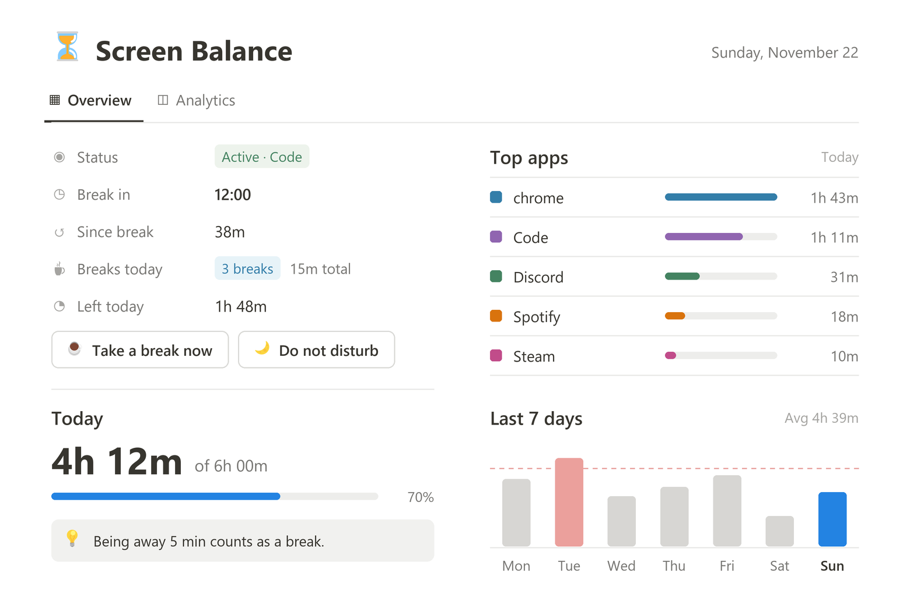
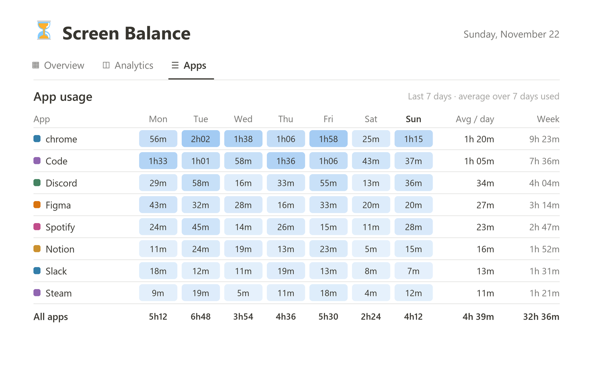

# Screen Balance

**A calm, Notion-inspired Windows tray app that reminds you to take breaks and shows where your screen time goes.**

<picture>
  <source media="(prefers-color-scheme: dark)" srcset="docs/dashboard-dark.png">
  
</picture>

## Download

| | |
|---|---|
| **Windows app** (recommended) | **[⬇ Download ScreenBalance.exe](https://github.com/Catalyst-733/screen-balance/releases/latest/download/ScreenBalance.exe)**: no install, no Python. Put it in a permanent folder and double-click it. |
| **Microsoft Store** | Coming soon. |
| **From source** | Python 3.10+: `pip install -r requirements.txt`, then `pythonw screen_balance.py` (or double-click `Start Screen Balance.bat`). |

> Windows may show *"Windows protected your PC"* the first time, because the exe isn't code-signed. Click **More info → Run anyway**.

An hourglass appears in the system tray (click **^** on the taskbar if it's hidden). Double-click it for the dashboard, right-click for the menu. All versions are on the [Releases page](https://github.com/Catalyst-733/screen-balance/releases).

## Features

- **Break reminders.** After 50 minutes of use, a small popup offers a break or a snooze. A **Break in 12:34** countdown shows on the dashboard, in the tray menu and on hover.
- **Full-screen break timer** on every monitor, with tips to stretch, rest your eyes or drink water. Or take an **open break** that counts up until you click **I'm back**.
- **Daily limit** (6 h by default), with a heads-up at 80% and reminders while you're over.
- **Dashboard** with three tabs: **Overview** (today, top apps, last 7 days), **Analytics** (activity by hour, breaks, longest stretch) and **Apps** (each app's time per day this week).
- **A tray icon that shows your day**: the hourglass sand turns from blue to orange to red as you near your limit, and shows a moon during Do not disturb.
- **Do not disturb** for 30 min, 1 h, 2 h or until you turn it off. Windows' own Do not disturb and Focus are respected too.
- **Only real use counts.** Counting stops when you're idle, locked or asleep, but a playing video still counts.
- **Add time by hand** for time spent on another device.
- **Light and dark mode**, following Windows by default, with smooth animations at your screen's refresh rate.

<picture>
  <source media="(prefers-color-scheme: dark)" srcset="docs/break-timer-dark.png">
  
</picture>

<picture>
  <source media="(prefers-color-scheme: dark)" srcset="docs/apps-dark.png">
  
</picture>

## Settings

Break interval (50 min), break length (5 min), snooze (10 min), daily limit (6 h, 0 = off), idle time before counting stops (2 min), theme, **Start with Windows**, respect Windows Do not disturb, count videos, and the startup notification. Open them from the tray menu.

## Privacy

**100% offline**: no network connections, no account, no telemetry, no ads. It records only **app names and minutes**, never window titles, websites or keystrokes. Everything stays in `%USERPROFILE%\.screenbalance\` (the last 60 days); delete that folder to reset. See [PRIVACY.md](PRIVACY.md).

## Good to know

- Video detection needs sound: a muted video doesn't count as watching.
- Popups appear on the main monitor; exclusive-fullscreen games can draw over them (borderless mode works).
- Apps are tracked by name, so all browser tabs count as one app.
- It's a helper, not parental control: anyone can quit it.

## For developers

How the exe is built (Nuitka: Python → C → exe), how to publish a release or the Microsoft Store package, and the project layout: see [docs/BUILDING.md](docs/BUILDING.md).

## License

[MIT](LICENSE)
