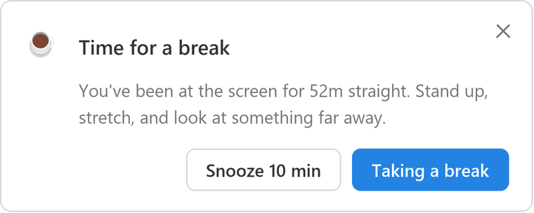
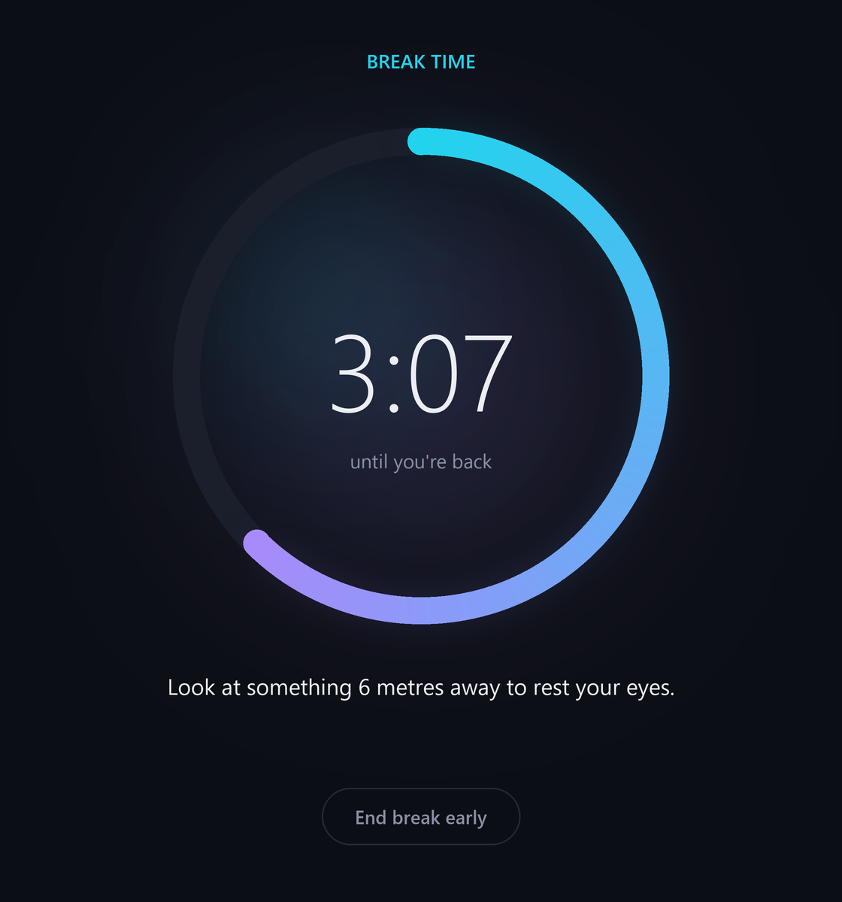
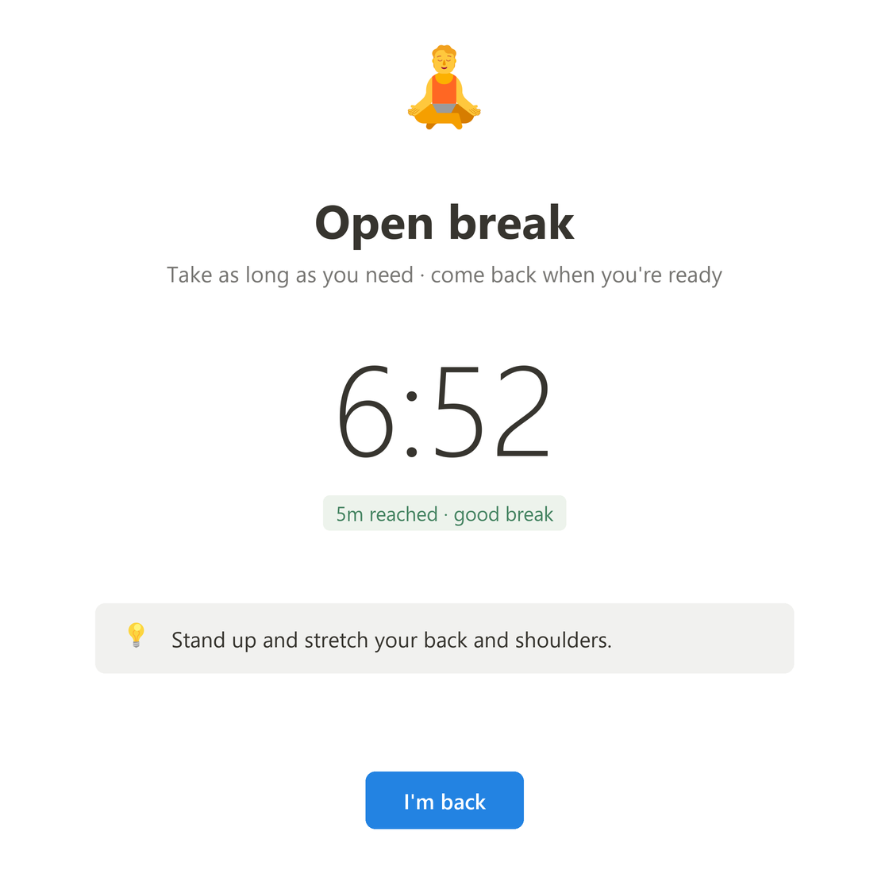
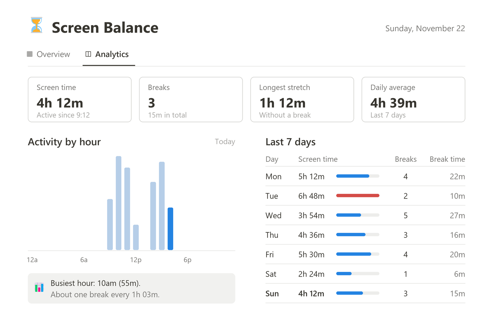

<div align="center">

# Screen Balance

**A calm, Notion-inspired Windows tray app that helps you not overuse your PC.**

It reminds you to take breaks, keeps an eye on your daily screen time, and shows you where your hours actually go.


<picture>
  <source media="(prefers-color-scheme: dark)" srcset="docs/dashboard-dark.png">
  
</picture>

</div>

---

## Why

It's easy to sit down "for a minute" and look up three hours later. Screen Balance runs quietly in the system tray and gives you a gentle nudge at the right moments. It doesn't lock you out or nag you. It just makes your screen time visible and reminds you to step away.

## Features

### Break reminders
After **50 minutes** of continuous use, a small popup slides in from the bottom-right corner. You can snooze it for 10 minutes, or click **Taking a break** to start the break timer.

A live **Break in 12:34** countdown shows how long until your next break: on the dashboard, in the tray menu, and when you hover over the tray icon. The countdown only runs while you're actually using the PC.



### Full-screen break timer
When the break starts, a clean full-screen page covers **every monitor, on top of everything including the taskbar**, with a countdown until the break is over (5 minutes by default). It shows a new tip every 20 seconds: stretch, rest your eyes, drink water. When time's up it chimes, tells you which break of the day that was, and waits for you to click **Back to work**.

Need to get back urgently? **End break early** is always there. Ending early counts as a snooze, so you'll be reminded again in 10 minutes.

**Trigger a break whenever you want:** click **☕ 5 min break** on the dashboard, or choose it from the tray menu.

<p>
<picture>
  <source media="(prefers-color-scheme: dark)" srcset="docs/break-timer-dark.png">
  
</picture>

</p>

### Open break: stop when you want
Sometimes you don't know how long you'll be away: lunch, a call, a walk. Click **🧘 Open break** on the dashboard (or **Take an open break** in the tray menu). The same full-screen page covers everything, but instead of a countdown a timer **counts up** while you're away. Click **I'm back** whenever you're ready.

- It's **recorded in Analytics** like any other break: it counts toward *Breaks* and *Break time*.
- Once you've been away for your break length (5 min by default), a green tag tells you it was a good break, and the 50-minute timer starts fresh when you come back.
- Shorter open breaks still count as breaks, but your current stretch continues.
- Ending it within 10 seconds counts as a misclick, so nothing is recorded.

<picture>
  <source media="(prefers-color-scheme: dark)" srcset="docs/open-break-dark.png">
  
</picture>

Being away from the PC for 5 minutes, or putting it to sleep, also counts as a break and resets the timer automatically.

### Daily time limit
Set a daily screen-time budget (default **6 hours**). You get a heads-up at **80%**, a notice when you reach it, and a reminder every 30 minutes while you're over.


### Dashboard: Overview
Double-click the tray icon to open the dashboard, laid out like a Notion page:

- **Status**, **Break in** (live countdown), **Since break**, **Breaks today** and **Left today**, shown as page properties
- **☕ 5 min break**, **🧘 Open break** and **🌙 DND** buttons
- **Today's total** with a progress bar that turns orange, then red, as you approach your limit
- **Top apps**: which programs your time goes to
- **Last 7 days**: a bar chart with your limit drawn as a dashed line

### Dashboard: Analytics
Switch to the **Analytics** tab for the detail:

- **Screen time**, with what time you started today
- **Breaks**: how many you took today and the total break time
- **Longest stretch** without a break
- **Daily average** over the last 7 days
- **Activity by hour**: when in the day you use your PC, with your busiest hour
- **Last 7 days table**: screen time, number of breaks and break time for each day

### Dashboard: Apps
The **Apps** tab is a table of your app usage for the last 7 days:

- **One row per app** (your top 9 this week, the rest grouped as *Other*).
- **One column per day** showing how long you used that app; busier days are shaded darker.
- **Avg / day**: each app's daily average this week, counted over the days you actually used the PC.
- **Week**: each app's total for the week.
- **All apps**: your total for each day, your overall daily average and your week total.

<picture>
  <source media="(prefers-color-scheme: dark)" srcset="docs/apps-dark.png">
  
</picture>

**Add time by hand.** Used a laptop, your phone, or this PC while Screen Balance wasn't running? Click **＋ Add time** in Analytics. Pick the day (any of the last 7), a start time and how long, and optionally what it was. It's spread across the right hours, counts everywhere like tracked time, and the Screen time card shows how much was added. Each entry is listed in that window with a **Remove** link in case you get it wrong.

<picture>
  <source media="(prefers-color-scheme: dark)" srcset="docs/analytics-dark.png">
  
</picture>

Breaks are counted whether you finish the break timer, take an open break, step away for 5+ minutes, or put the PC to sleep.

### A tray icon that tells you how you're doing
The icon is a small Notion-style tile with an hourglass whose sand shows your day. It drains from the top into the bottom as you approach your daily limit: blue while you're on track, orange near your limit, red when you're over. During Do not disturb it shows a moon. The tile is light or dark to match your taskbar, so you can check your day without opening anything.

<picture>
  <source media="(prefers-color-scheme: dark)" srcset="docs/tray-icons-dark.png">
  
</picture>

<sub>On track · close to the limit · over the limit · do not disturb</sub>

### Do not disturb
For moments when you need to be fully focused, such as an exam, a meeting, a presentation or deep work, turn on **Do not disturb**:

- **Nothing pops up:** no break reminders and no limit warnings. A popup already on screen disappears too.
- Choose **30 minutes, 1 hour, 2 hours, or until you turn it off** from the tray menu, or click **🌙 DND** on the dashboard for an hour.
- Your screen time is **still tracked**, and you can still start a break yourself.
- The tray icon shows a moon, and the dashboard shows when DND ends.
- It stays on through a restart or reboot until its end time.
- When DND ends you get **at most one** catch-up reminder if a break is overdue. Nothing piles up.

**Windows' own Do not disturb / Focus counts too.** While it's on (including during a Focus session from the Clock app), break popups and limit warnings stay quiet in exactly the same way, and the dashboard shows **Windows Do not disturb**. You can turn this off in Settings (*Respect Windows Do not disturb*).

### Light and dark mode
Choose **System**, **Light** or **Dark** under *Appearance* in Settings. **System** (the default) follows your Windows light/dark setting and switches automatically when you change it. The dashboard, popups, break screen, settings and even the window title bars follow along. The images in this README match your GitHub theme too.

### Only *real* use counts
Time only counts while you're actually using the PC. Counting stops after 2 minutes without mouse or keyboard input, while the screen is locked, and while the PC sleeps.

**Videos count.** While a video plays, Screen Balance keeps counting even though you're not touching anything, and the dashboard shows **Watching video**. It looks for two things at once: an app asking Windows to keep the screen on (browsers and video players do this while a video plays), or a full-screen app; **and** sound actually playing. Requiring sound matters because some apps (Discord, Medal, OBS, keep-awake tools) keep the screen on all the time, which on its own would hide real breaks.

- Watching never counts as a break, however long the video.
- After a video ends, time is counted normally again until *Idle after* kicks in.
- As a safety net, after 3 hours with no input at all it stops counting anyway, in case a "keep my PC awake" tool is holding the screen on.
- You can switch it off in Settings (*Count videos as screen time*). Store apps are counted under their own names, for example *Calculator* instead of *ApplicationFrameHost*.

### Smooth and lightweight
All drawing happens on a background thread, so the UI never waits on a redraw.

- **Animations are locked to your display's refresh rate:** every frame waits for the screen's next refresh, so the popup slide-in and the break-screen fade run at 240 fps on a 240 Hz monitor (144 on 144 Hz, 60 on 60 Hz) with evenly spaced frames.
- **Everything eases instead of snapping:**
  - Hover highlights fade in and out.
  - Switching between Overview and Analytics crossfades.
  - The dashboard and Settings fade in and out.
  - Popups slide in and slide away.
  - The break screen fades in and out.
- **Hover starts on the very next frame:** each button's hover look, including the in-between steps of its fade, is drawn once in advance.
- **The countdowns tick exactly on the second.**
- **The tray menu** is only rebuilt when its text changes.
- **No extra power use when idle:** nothing animates, and the PC can still sleep normally.

### Settings
Everything is adjustable, including whether it starts with Windows. The small **GitHub ↗** link at the bottom opens this page.

<picture>
  <source media="(prefers-color-scheme: dark)" srcset="docs/settings-dark.png">
  
</picture>

| Setting | Default | Range |
|---|---|---|
| Break reminder after | 50 min | 5–240 min |
| Break length (break timer, and away time that resets the timer) | 5 min | 1–60 min |
| Snooze | 10 min | 1–60 min |
| Daily limit (0 = off) | 6 h | 0–24 h |
| Stop counting after no input for | 120 sec | 30–1800 sec |
| Repeat the over-limit warning every | 30 min | 5–240 min |
| Appearance | System | System, Light, Dark |
| Start with Windows | On (after you turn it on once) | On, Off |
| Respect Windows Do not disturb | On | On, Off |
| Count videos as screen time | On | On, Off |
| Notify me when it starts | On | On, Off |

## Privacy

Screen Balance is **100% offline**:

- It makes no network connections and has no account, telemetry or ads. (The GitHub link in Settings only opens this page in your browser when you click it.)
- It records **only app names and minutes**. No window titles, URLs, keystrokes or screenshots.
- Everything stays in one folder on your PC: `%USERPROFILE%\.screenbalance\`
- It needs no administrator rights.

## Getting started

### Option A: download the app (no Python needed)

1. Open the [Actions tab](https://github.com/Catalyst-733/screen-balance/actions/workflows/build-exe.yml), click the latest green **Build Windows exe** run, and download **ScreenBalance-exe** under *Artifacts* (you need to be signed in to GitHub).
2. Unzip it and move `ScreenBalance.exe` somewhere permanent, for example `%LOCALAPPDATA%\Programs\Screen Balance\`.
3. Double-click `ScreenBalance.exe`.

> Windows SmartScreen may warn about an unknown publisher the first time, because the exe isn't code-signed. Click **More info → Run anyway**.

A Microsoft Store version is on its way; once it's published, that will be the easiest way to install and update it.

### Option B: run from source

**1. Install Python 3.10+** from [python.org](https://www.python.org/downloads/) or the Microsoft Store.

**2. Download and install the dependencies:**

```powershell
git clone https://github.com/Catalyst-733/screen-balance.git
cd screen-balance
python -m pip install --user -r requirements.txt   # needs Pillow 13+, which has no known vulnerabilities
```

**3. Run it:** double-click **`Start Screen Balance.bat`**, or run:

```powershell
pythonw screen_balance.py
```

### Once it's running

An hourglass icon appears in the system tray. If you don't see it, click the **^** arrow on the taskbar.

To have it start with Windows, turn on **Start with Windows** in Settings or in the tray menu.

When it starts, a small Windows notification tells you **Screen Balance is running**, so you know it's on even when Windows hides the icon behind the **^** arrow. You can switch the notification off in Settings, and it never shows during Do not disturb.

> **Can't see the icon?** Windows 11 hides new tray icons. To always show it, go to **Taskbar settings → Other system tray icons** and turn on the entry for Screen Balance. It's listed as *ScreenBalance* for the downloaded app, or as *Python* / *pythonw* when you run it from source (Task Manager's **Startup apps** shows *pythonw.exe* in that case too, because Python runs the app).

### Using it

| Action | How |
|---|---|
| Open the dashboard | Double-click the tray icon |
| Take a timed break right now | **☕ 5 min break** on the dashboard, or the tray menu |
| Take an open break (stop when you want) | **🧘 Open break** on the dashboard, or the tray menu |
| See time until your next break | Hover over the tray icon, open the tray menu, or look at the dashboard |
| Do not disturb (30 min, 1 h, 2 h, or until turned off) | Tray menu → **Do not disturb**, or **🌙 DND** on the dashboard (1 hour) |
| Breaks, settings, start with Windows, quit | Right-click the tray icon |

## Known limitations

- **Video detection needs sound.** A muted video doesn't count as watching. Music playing while an app like Discord or Medal keeps the screen on can count as watching (up to 3 hours without input).
- **Popups show on the main monitor**, even if you're working on another screen.
- **Exclusive fullscreen games** may draw over the popups and the break timer. Borderless/windowed mode works fine.
- **Windows only.** It uses Windows APIs to detect input and the active app.
- **Tracking is by process name**, so all browser tabs count as one app (for example `chrome`).
- **Not a parental-control tool.** It's built to help you, not to enforce limits. Anyone at the PC can quit it.

## Your data

| File | What's in it |
|---|---|
| `config.json` | Your settings |
| `usage.json` | Per day (last 60 days): total and per-app time, activity by hour, breaks and break time, longest stretch |
| `state.json` | Whether Do not disturb is on and until when, plus your current stretch so a quick restart doesn't reset your break timer |
| `usage.pending.json` | Only while `usage.json` is locked by another program: this session's time, merged in automatically later |
| `error.log` | Only created if something goes wrong |

To reset everything, quit the app and delete the `.screenbalance` folder.

Your history is protected:

- If a data file ever gets damaged, it's kept as a `*.corrupt-<date>` backup instead of being overwritten.
- If it's temporarily locked (by antivirus or a backup tool), the app keeps tracking in memory and merges into the file once it can be read again.
- It saves every 30 seconds and when Windows shuts down.
- Starting it again while it's running (for example double-clicking **Start Screen Balance.bat**) restarts it cleanly: the running copy saves and steps aside, and your current stretch and break countdown carry over.
- Anything unexpected is written to `error.log`.

## Building and publishing

### The .exe

`ScreenBalance.exe` is built by the **Build Windows exe** workflow on every push: [Nuitka](https://nuitka.net) translates the Python code to C and compiles it into a single native Windows program, and the workflow checks that it starts. To build it yourself on Windows, run `pip install -r requirements.txt nuitka`, then the same `python -m nuitka ...` command as in [`build-exe.yml`](.github/workflows/build-exe.yml).

### The Microsoft Store package

The **Build Store package (MSIX)** workflow makes `ScreenBalance.msix`, the file you upload in Partner Center, then installs it on the build machine and checks that it starts. The Store signs the package, so you don't need a code-signing certificate. To publish:

1. Create a developer account at [Partner Center](https://partner.microsoft.com/dashboard) (Apps and games), then **reserve the name** "Screen Balance" (pick another if it's taken).
2. In Partner Center, open **Product management → Product identity** and copy *Package/Identity/Name*, *Package/Identity/Publisher* and *Package/Properties/PublisherDisplayName* into the repository variables `MSIX_IDENTITY_NAME`, `MSIX_PUBLISHER` and `MSIX_PUBLISHER_DISPLAY_NAME` (GitHub: **Settings → Secrets and variables → Actions → Variables**). Without them the package builds with test values that the Store won't accept.
3. Run **Build Store package (MSIX)** from the Actions tab (**Run workflow**, with a version like `1.0.0.0`; raise it for each update, keeping the last number `0`) and download **ScreenBalance-msix**.
4. Create a submission: upload the `.msix` under **Packages**, fill in the listing from [`docs/store-listing.md`](docs/store-listing.md), use [`PRIVACY.md`](PRIVACY.md) as the privacy policy URL, and explain the `runFullTrust` capability with the text given there.

In the Store version, **Start with Windows** uses Windows' startup task instead of the registry (Store apps can't write to the registry's startup list), so it also shows under **Settings → Apps → Startup**. The data folder is the same, `%USERPROFILE%\.screenbalance\`.

## Project layout

```
screen_balance.py      tracking, reminders, tray menu and windows
design.py              Notion-style drawing for the dashboard, popups, break
                       timer and tray icon (Pillow, rendered at 2x)
tools/
  make_screenshots.py  regenerates the images in docs/ from demo data
  make_icon.py         draws the .exe icon and the Store logos
packaging/msix/        Store package manifest and its extra requirements
.github/workflows/
  build-exe.yml        compiles ScreenBalance.exe (Nuitka: Python -> C -> exe)
  build-msix.yml       builds ScreenBalance.msix for the Microsoft Store
PRIVACY.md             privacy policy (linked from the Store listing)
docs/                  README images
Start Screen Balance.bat
```

## License

[MIT](LICENSE). Free to use, modify and share.
