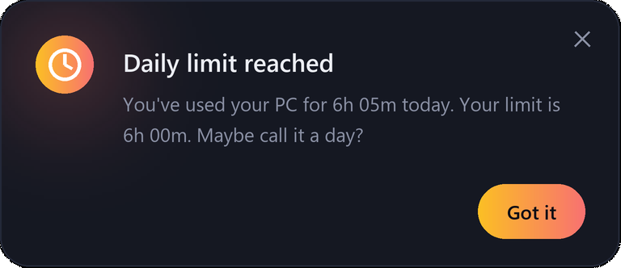

<div align="center">

# Screen Balance

**A calm, good-looking Windows tray app that helps you not overuse your PC.**

It reminds you to take breaks, keeps an eye on your daily screen time, and shows you where your hours actually go.


</div>

---

## Why

It's easy to sit down "for a minute" and look up three hours later. Screen Balance runs quietly in the system tray and gives you a gentle nudge at the right moments. It doesn't lock you out or nag you. It just makes your screen time visible and reminds you to step away.

## Features

### Break reminders
After **50 minutes** of continuous use, a small popup slides in from the bottom-right corner. Take the break or snooze it for 10 minutes. Being away for **5 minutes** counts as a break and resets the timer automatically, and so does putting the PC to sleep.


### Daily time limit
Set a daily screen-time budget (default **6 hours**). You get a heads-up at **80%**, a notice when you reach it, and a reminder every 30 minutes while you're over.



### Per-app tracking and a dashboard
Double-click the tray icon to open the dashboard:

- **Today's total**, shown as a ring that fills up through the day and shifts from cyan to amber to red as you approach your limit
- **Since break** and **left today** at a glance
- **Top apps**: which programs your time goes to
- **Last 7 days**: a bar chart with your limit drawn as a dashed line

### A tray icon that tells you how you're doing
The icon is a small progress ring, so you can check your day without opening anything.


<sub>On track · close to the limit · over the limit · reminders paused</sub>

### Only *real* use counts
Time only counts while you're actually using the PC. Counting stops after 2 minutes without mouse or keyboard input, while the screen is locked, and while the PC sleeps.

### Settings
Everything is adjustable, including whether it starts with Windows.


| Setting | Default | Range |
|---|---|---|
| Break reminder after | 50 min | 5–240 min |
| Break length (away time that resets the timer) | 5 min | 1–60 min |
| Snooze | 10 min | 1–60 min |
| Daily limit (0 = off) | 6 h | 0–24 h |
| Stop counting after no input for | 120 sec | 30–1800 sec |
| Repeat the over-limit warning every | 30 min | 5–240 min |

## Privacy

Screen Balance is **100% offline**:

- It makes no network connections and has no account, telemetry or ads.
- It records **only app names and minutes**. No window titles, URLs, keystrokes or screenshots.
- Everything stays in one folder on your PC: `%USERPROFILE%\.screenbalance\`
- It needs no administrator rights.

## Getting started

**1. Install Python 3.10+** from [python.org](https://www.python.org/downloads/) or the Microsoft Store.

**2. Download and install the dependencies:**

```powershell
git clone https://github.com/Catalyst-733/screen-balance.git
cd screen-balance
python -m pip install --user -r requirements.txt
```

**3. Run it:** double-click **`Start Screen Balance.bat`**, or run:

```powershell
pythonw screen_balance.py
```

A ring icon appears in the system tray. If you don't see it, click the **^** arrow on the taskbar.

**4. (Optional) Start it with Windows:** turn on **Start with Windows** in Settings or in the tray menu.

### Using it

| Action | How |
|---|---|
| Open the dashboard | Double-click the tray icon |
| Settings, pause reminders for 1 hour, start with Windows, quit | Right-click the tray icon |
| Quick look at today | Hover over the tray icon |

## Known limitations

- **Videos count as idle.** If you watch something without touching the mouse or keyboard, time stops counting after 2 minutes. Raise *Idle after* in Settings if you want that time to count.
- **Popups show on the main monitor**, even if you're working on another screen.
- **Exclusive fullscreen games** may draw over the popups. Borderless/windowed mode works fine.
- **Windows only.** It uses Windows APIs to detect input and the active app.
- **Tracking is by process name**, so all browser tabs count as one app (for example `chrome`).
- **Not a parental-control tool.** It's built to help you, not to enforce limits. Anyone at the PC can quit it.

## Your data

| File | What's in it |
|---|---|
| `config.json` | Your settings |
| `usage.json` | Daily totals per app (the last 60 days) |
| `error.log` | Only created if something goes wrong |

To reset everything, quit the app and delete the `.screenbalance` folder. If a data file ever gets damaged, it's kept as a `*.corrupt-<date>` backup instead of being overwritten.

## Project layout

```
screen_balance.py      tracking, reminders, tray menu and windows
design.py              drawing for the dashboard, popups and tray icon
                       (Pillow, rendered at 2x for smooth edges)
tools/
  make_screenshots.py  regenerates the images in docs/ from demo data
docs/                  README images
Start Screen Balance.bat
```

## License

[MIT](LICENSE). Free to use, modify and share.
