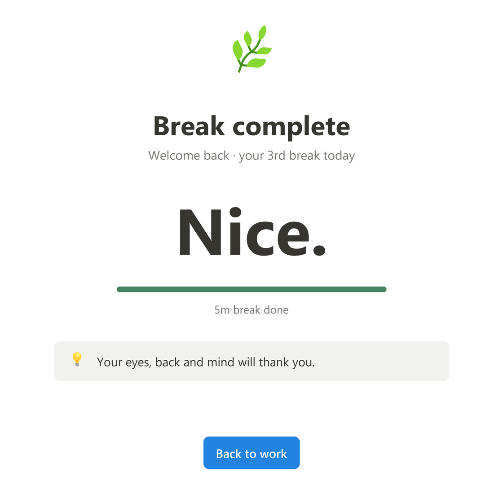
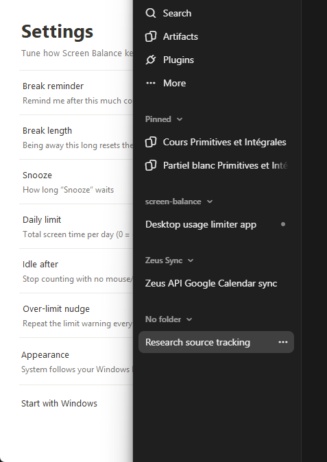

<div align="center">

# Screen Balance

**A calm, Notion-inspired Windows tray app that helps you not overuse your PC.**

It reminds you to take breaks, keeps an eye on your daily screen time, and shows you where your hours actually go.


<picture>
  <source media="(prefers-color-scheme: dark)" srcset="docs/dashboard-dark.png">
  
</picture>

</div>

---

## Why

It's easy to sit down "for a minute" and look up three hours later. Screen Balance runs quietly in the system tray and gives you a gentle nudge at the right moments. It doesn't lock you out or nag you. It just makes your screen time visible and reminds you to step away.

## Features

### Break reminders
After **50 minutes** of continuous use, a small popup slides in from the bottom-right corner. You can snooze it for 10 minutes, or click **Taking a break** to start the break timer.

A live **Break in 12:34** countdown shows how long until your next break: on the dashboard, in the tray menu, and when you hover over the tray icon. The countdown only runs while you're actually using the PC.


### Full-screen break timer
When the break starts, a clean full-screen page covers **every monitor, on top of everything including the taskbar**, with a countdown until the break is over (5 minutes by default). It shows a new tip every 20 seconds: stretch, rest your eyes, drink water. When time's up it chimes, tells you which break of the day that was, and waits for you to click **Back to work**.

Need to get back urgently? **End break early** is always there. Ending early counts as a snooze, so you'll be reminded again in 10 minutes.

**Trigger a break whenever you want:** click **☕ Take a break now** on the dashboard, or choose it from the tray menu.

<p>
<picture>
  <source media="(prefers-color-scheme: dark)" srcset="docs/break-timer-dark.png">
  
</picture>

</p>

Being away from the PC for 5 minutes, or putting it to sleep, also counts as a break and resets the timer automatically.

### Daily time limit
Set a daily screen-time budget (default **6 hours**). You get a heads-up at **80%**, a notice when you reach it, and a reminder every 30 minutes while you're over.


### Dashboard: Overview
Double-click the tray icon to open the dashboard, laid out like a Notion page:

- **Status**, **Break in** (live countdown), **Since break**, **Breaks today** and **Left today**, shown as page properties
- **☕ Take a break now** button
- **Today's total** with a progress bar that turns orange, then red, as you approach your limit
- **Top apps**: which programs your time goes to
- **Last 7 days**: a bar chart with your limit drawn as a dashed line

### Dashboard: Analytics
Switch to the **Analytics** tab for the detail:

- **Screen time**, with what time you started today
- **Breaks**: how many you took today and the total break time
- **Longest stretch** without a break
- **Daily average** over the last 7 days
- **Activity by hour**: when in the day you use your PC, with your busiest hour
- **Last 7 days table**: screen time, number of breaks and break time for each day

<picture>
  <source media="(prefers-color-scheme: dark)" srcset="docs/analytics-dark.png">
  
</picture>

Breaks are counted whether you finish the break timer, step away for 5+ minutes, or put the PC to sleep.

### A tray icon that tells you how you're doing
The icon is a small progress ring that fills with your day: blue while you're on track, orange near your limit, red when you're over. You can check your day without opening anything.


<sub>On track · close to the limit · over the limit · do not disturb</sub>

### Do not disturb
For moments when you need to be fully focused, such as an exam, a meeting, a presentation or deep work, turn on **Do not disturb**:

- **Nothing pops up:** no break reminders and no limit warnings. A popup already on screen disappears too.
- Choose **30 minutes, 1 hour, 2 hours, or until you turn it off** from the tray menu, or click **🌙 Do not disturb** on the dashboard for an hour.
- Your screen time is **still tracked**, and **Take a break now** still works if you decide to.
- The tray icon turns into a purple moon, and the dashboard shows when DND ends.
- When DND ends you get **at most one** catch-up reminder if a break is overdue. Nothing piles up.

### Light and dark mode
Choose **System**, **Light** or **Dark** under *Appearance* in Settings. **System** (the default) follows your Windows light/dark setting and switches automatically when you change it. The dashboard, popups, break screen, settings and even the window title bars follow along. The images in this README match your GitHub theme too.

### Only *real* use counts
Time only counts while you're actually using the PC. Counting stops after 2 minutes without mouse or keyboard input, while the screen is locked, and while the PC sleeps.

### Settings
Everything is adjustable, including whether it starts with Windows.

<picture>
  <source media="(prefers-color-scheme: dark)" srcset="docs/settings-dark.png">
  
</picture>

| Setting | Default | Range |
|---|---|---|
| Break reminder after | 50 min | 5–240 min |
| Break length (break timer, and away time that resets the timer) | 5 min | 1–60 min |
| Snooze | 10 min | 1–60 min |
| Daily limit (0 = off) | 6 h | 0–24 h |
| Stop counting after no input for | 120 sec | 30–1800 sec |
| Repeat the over-limit warning every | 30 min | 5–240 min |
| Appearance | System | System, Light, Dark |

## Privacy

Screen Balance is **100% offline**:

- It makes no network connections and has no account, telemetry or ads.
- It records **only app names and minutes**. No window titles, URLs, keystrokes or screenshots.
- Everything stays in one folder on your PC: `%USERPROFILE%\.screenbalance\`
- It needs no administrator rights.

## Getting started

**1. Install Python 3.10+** from [python.org](https://www.python.org/downloads/) or the Microsoft Store.

**2. Download and install the dependencies:**

```powershell
git clone https://github.com/Catalyst-733/screen-balance.git
cd screen-balance
python -m pip install --user -r requirements.txt
```

**3. Run it:** double-click **`Start Screen Balance.bat`**, or run:

```powershell
pythonw screen_balance.py
```

A ring icon appears in the system tray. If you don't see it, click the **^** arrow on the taskbar.

**4. (Optional) Start it with Windows:** turn on **Start with Windows** in Settings or in the tray menu.

### Using it

| Action | How |
|---|---|
| Open the dashboard | Double-click the tray icon |
| Take a break right now | **☕ Take a break now** on the dashboard, or the tray menu |
| See time until your next break | Hover over the tray icon, open the tray menu, or look at the dashboard |
| Do not disturb (30 min, 1 h, 2 h, or until turned off) | Tray menu → **Do not disturb**, or **🌙 Do not disturb** on the dashboard (1 hour) |
| Take a break now, settings, start with Windows, quit | Right-click the tray icon |

## Known limitations

- **Videos count as idle.** If you watch something without touching the mouse or keyboard, time stops counting after 2 minutes. Raise *Idle after* in Settings if you want that time to count.
- **Popups show on the main monitor**, even if you're working on another screen.
- **Exclusive fullscreen games** may draw over the popups and the break timer. Borderless/windowed mode works fine.
- **Windows only.** It uses Windows APIs to detect input and the active app.
- **Tracking is by process name**, so all browser tabs count as one app (for example `chrome`).
- **Not a parental-control tool.** It's built to help you, not to enforce limits. Anyone at the PC can quit it.

## Your data

| File | What's in it |
|---|---|
| `config.json` | Your settings |
| `usage.json` | Per day (last 60 days): total and per-app time, activity by hour, breaks and break time, longest stretch |
| `error.log` | Only created if something goes wrong |

To reset everything, quit the app and delete the `.screenbalance` folder. If a data file ever gets damaged, it's kept as a `*.corrupt-<date>` backup instead of being overwritten.

## Project layout

```
screen_balance.py      tracking, reminders, tray menu and windows
design.py              Notion-style drawing for the dashboard, popups, break
                       timer and tray icon (Pillow, rendered at 2x)
tools/
  make_screenshots.py  regenerates the images in docs/ from demo data
docs/                  README images
Start Screen Balance.bat
```

## License

[MIT](LICENSE). Free to use, modify and share.
